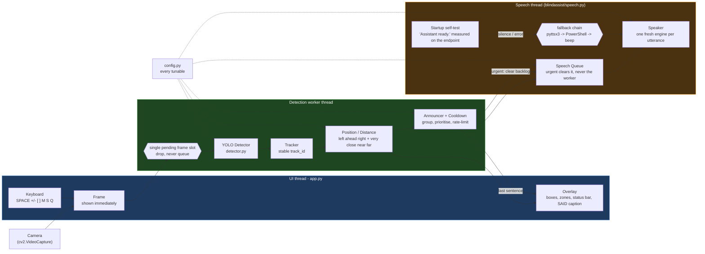

# BlindAssist Architecture

## Pipeline

The chain you asked for, as an actual Mermaid diagram (renders on GitHub, VS Code
Markdown preview, and any Mermaid viewer):



Read it left to right: **camera → frame → YOLO detector → tracker →
position/distance → announcer + cooldown → speech queue → speaker**, with the
video overlay fed from the same position/announcer output.

Three threads, one rule between them:

| Thread | Owns | Never does |
|---|---|---|
| **UI** (`app.py`) | capture, drawing, keys | waits for inference |
| **Worker** | detector → tracker → positioner → announcer | touches cv2 windows |
| **Speech** | TTS queue playback + backend fallback | blocks anything else |

The UI hands each frame to the worker through a **single slot**. If the worker is
busy, the frame is **dropped, never queued** — that is what keeps the preview
smooth and memory flat.

## Module responsibilities

| Module | Job | Key ideas |
|--------|-----|-----------|
| `config.py` | Single source of truth for tunables | dataclasses; COCO class whitelist; area-ratio thresholds for distance |
| `detector.py` | Run YOLO, return clean `Detection` objects | lazy model load; one-time weight download; class whitelist filter |
| `tracker.py` | Give each object a stable `track_id` | greedy IoU matching; lost-frame expiry; `trend()` from box-height history |
| `position.py` | Turn a box into words + a distance band | 3 vertical bands → left / ahead / right; area ratio → very close / near / far |
| `announcer.py` | Decide **what** and **when** to say | grouping + pluralisation, per-object cooldown, nearest-first priority, top-N per cycle |
| `speech.py` | Speak, without blocking vision | one worker thread + queue; **a fresh pyttsx3 engine per utterance**; backend fallback `pyttsx3 -> powershell -> beep`; startup self-test measured on the real output endpoint; full tracebacks in `logs/speech.log` |
| `app.py` | Wire it all together + CLI | Windows DirectShow capture; worker thread; OpenCV overlay; headless mode |

## Design decisions

- **Separation of "see" vs "speak".** Perception (detector/tracker/positioner) is
  pure and testable without audio or a camera. Only `app.py` touches cv2 windows.
- **Rate limiting is centralised** in `announcer.py` so no single object can
  dominate and the app never talks continuously.
- **No ultralytics types leak out.** `detector.py` converts to plain dataclasses,
  so tests can build `Detection`/`Position` without loading a model.
- **Drop, don't queue.** A bounded single-frame slot means the worst case under
  load is a stale preview, never unbounded memory growth.
- **CPU-only by default.** The nano weights + CPU torch keep the footprint small
  and offline-friendly; the device auto-selects CUDA when one is available.

## Direction model

The frame is split into **three equal vertical bands**. The horizontal centre of
the bounding box decides the words:

| Box centre x | Spoken as |
|---|---|
| `< W/3` | "on your left" |
| `< 2W/3` | "ahead" |
| otherwise | "on your right" |

The same thirds are drawn on screen as dashed guides.

## Distance model (area ratio — **not** a pinhole model)

There is no depth sensor and no focal-length assumption. The estimate is purely
how much of the frame the box covers:

```
area_ratio = box_area / (frame_width * frame_height)

area_ratio >= 0.20  ->  "very close"
area_ratio >= 0.05  ->  "near"
otherwise           ->  "far"
```

This assumes objects are roughly comparable in real size, so it separates "right
in front of you" from "across the room" but is **not** a measurement in metres.
A small nearby object can look like a large distant one — see
[Known limitations](../README.md#known-limitations).

## Speech path

1. `announcer.update()` receives the current `Position` list.
2. It groups by label ("3 chairs ahead"), sorts nearest-first, and keeps a few
   per cycle.
3. Per object it enforces `cooldown_s`, but a brand-new or closer object may
   speak sooner.
4. Phrases are pushed to a **queue** drained by the TTS thread. An **urgent**
   phrase clears the queue and stops the utterance in progress so it is heard
   immediately; it never kills the worker thread.
5. If no TTS backend exists, `NullSpeaker` takes over: the app still runs and
   every phrase is printed as `[SPEAK]` and logged.

### How a phrase actually becomes sound

The queue is only half the story; the half that broke in the field is what
happens inside the worker:

1. `pythoncom.CoInitialize()` gives the worker its own COM apartment (SAPI5
   objects are COM objects).
2. The backend chain is built: **`pyttsx3`** (SAPI5, a real voice) ->
   **`powershell`** (System.Speech in a hidden subprocess, independent of
   pyttsx3) -> **`beep`** (a two-tone `winsound` pattern, so the user always
   hears *something*). `TTS_BACKEND` / `--tts-backend` pins one of them.
3. Before the first frame is processed the active backend must pass a
   **self-test**: it speaks `"Assistant ready."` while a pycaw peak meter
   watches the default output endpoint. A backend that raises, or that
   "succeeds" with a silent endpoint (peak <= 0.0005), is skipped and the next
   one is tried.
4. Every utterance gets a **fresh engine** (`pyttsx3.init()`), and the previous
   engine is discarded *before* the next one is created. This is not an
   optimisation, it is the bug fix - see below.
5. Each utterance is written to `logs/speech.log` as a `START` / `END` pair
   with wall-clock timestamps, duration, backend and measured peak, so silence
   is traceable after the fact. Nothing is swallowed: failures are logged with
   the full traceback.

### Why reusing one engine was silent

Measured on this machine with `scripts/probe_queue_order.py`:

* `Engine.runAndWait()` ends with `proxy.setBusy(False)`, so between two
  utterances the driver proxy is **not** busy.
* On utterance #2 `engine.say()` therefore runs immediately (its queue is
  empty) and only afterwards `runAndWait()` queues the `endLoop` command, so
  the queue is `[endLoop]` instead of `[say, endLoop]`.
* `startLoop` pops that lone `endLoop` first -> `DriverProxy.endLoop()` ->
  `SAPI5Driver.stop()` -> `voice.Speak("", 3)` (SVSPURGEBOTH): the utterance
  that was just started is **purged**. pyttsx3 reports
  `finished-utterance completed=False` after about 0.35 s and produces **no
  audio and no exception**.

Utterance #1 only worked because a brand-new proxy starts with `busy=True`.
So the app spoke the welcome line and then every object announcement was
silently discarded while `speech.py` reported success. The fix (fresh engine
per utterance, validated by `scripts/probe_cycles.py`) is what the self-test
now guards: if it ever regresses, the app says so on screen instead of being
quietly mute.

### Where the user can see it

* Status bar: `VOICE: ON (pyttsx3)` / `VOICE: MUTED` / `VOICE: FAILED`.
* `T` speaks a test line now; `M` mutes (the speaker drops text, it is not
  merely hidden); `--debug-speech` traces every stage to the console.
* A muted or zero Windows master volume shows a red on-screen warning, because
  that looks exactly like a bug otherwise.
* `python scripts/diagnose_audio.py` runs checks A-H (device, volume, voices,
  main thread, worker thread, queue design, PowerShell fallback, speaker
  hardware) and `--ask` runs the ear test.
